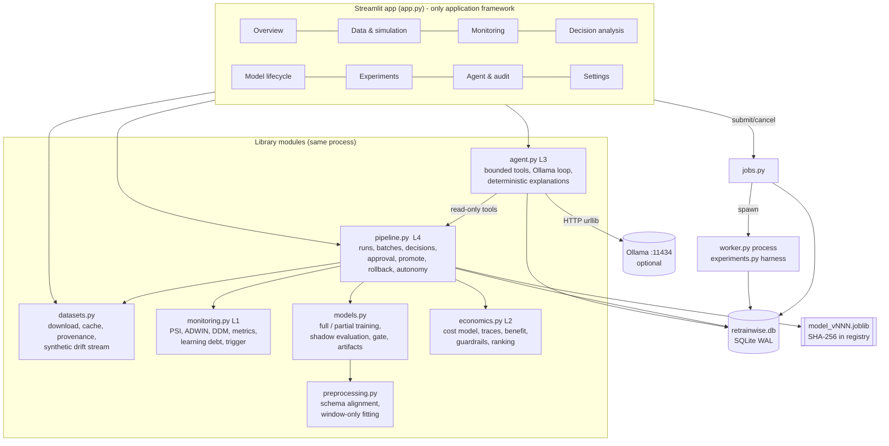
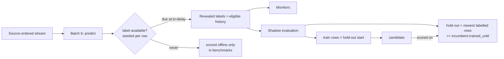

# Architecture

RetrainWise implements the proposal's four layers (monitoring, decision, orchestration and action) as Python modules
inside one Streamlit process, plus one optional worker process for long experiments.
SQLite (`retrainwise.db`, WAL mode) is the single source of truth.

## Component diagram



## Decision workflow (one batch to one action)

```mermaid
sequenceDiagram
  participant U as User / bounded autonomy
  participant P as pipeline.Lifecycle
  participant M as monitoring
  participant S as models.shadow_evaluate
  participant E as economics.rank_actions
  participant G as validation gate
  participant DB as SQLite
  U->>P: process_batch(run, expected_position)
  P->>P: predict batch with active model (prequential: predict first)
  P->>DB: store predictions; reveal labels whose delay has elapsed
  P->>M: errors -> ADWIN, DDM, rolling error, learning debt; batch -> PSI
  M-->>P: telemetry + status + evaluation trigger reasons
  U->>P: evaluate(run)  (idempotent per position/version/settings)
  P->>S: train full + partial candidates on rows before a chronological hold-out
  S-->>P: paired hold-out errors (incumbent vs candidates)
  P->>E: evidence + context (spend, cooldown, horizon, realisation factor)
  E-->>P: ranked defer/partial/full, itemised costs, guardrails, P(net>0)
  P->>DB: decision (pending), evaluation overhead charged
  U->>P: execute(decision, action, approver, approved=True)
  P->>DB: UNIQUE approval row (duplicate clicks fail), status executing
  P->>E: re-check guardrails with current spend
  P->>G: verify artifact SHA-256, recompute hold-out comparison, gate
  alt gate passes
    P->>DB: register model_vNNN, archive previous, reset monitors, start post-update tracking
  else gate fails
    P->>DB: candidate recorded as rejected, active model unchanged
  end
  Note over P,M: Next batches compare the new model against the retired one on new labels<br/>(realised reduction) which recalibrates future benefit estimates.
```

## Data flow and leakage boundaries



* Preprocessing (imputation medians, scaling, one-hot vocabularies, PSI bins) is fitted only on each model's training rows.
* An incremental update refuses rows earlier than the model's `trained_until`.
* The promoted candidate is exactly the validated object; it is never refitted on the hold-out.
* In benchmarks, a test corrupts every label after row 3,000 and checks that every online policy makes
  identical decisions up to that row (`test_no_future_label_leakage_in_online_policies`).

## Persistence model (SQLite tables)

| Table | Contents |
|---|---|
| `settings` | Active validated settings (JSON) |
| `runs` | One stream replay: dataset, size, seed, data checksum, position, spend, active version, monitor state (ADWIN window, DDM, learning debt, post-update tracker, realised outcomes) |
| `batches` | Per-batch telemetry JSON |
| `predictions` | Every prediction with label availability, due batch, reveal batch, error |
| `models` | Registry: version, artifact, SHA-256, parent, action, status (`active`/`archived`/`rolled_back`/`rejected`), training interval, metadata (schema, classes, seed, settings, validation) |
| `decisions` | Ranked decision payloads and status (`pending`/`executing`/`promoted`/`rejected`/`deferred`/`stale`/`interrupted`/`failed`) |
| `approvals` | One row per decision (UNIQUE), approver, mode (`manual`/`autonomous`), outcome |
| `execution_requests` | Requests prepared by the agent and awaiting human approval |
| `agent_reports`, `agent_tool_calls` | Explanations, mode, model, iterations, duration, and every tool call with validated arguments and result |
| `jobs` | Background experiment jobs: status, progress, heartbeat, PID, cancel flag, result, error |
| `events` | Append-only audit log |

`retrainwise.log` holds the same events as structured JSON lines.

## Long-running work and restarts

* Streamlit reruns never start work implicitly. Buttons call idempotent functions:
  `process_batch(expected_position)`, `evaluate` (keyed decision), and `execute` (UNIQUE approval).
* Benchmarks run in `worker.py` (`subprocess.Popen`, same folder). The worker claims a `queued` job once, writes a
  heartbeat every 5 seconds, checks the cancel flag between runs, and records `completed`, `cancelled` or `failed`.
* On application start, `jobs.recover` marks jobs whose heartbeat is older than 45 seconds as `interrupted`, and
  `Lifecycle.recover` marks decisions left in `executing` as `interrupted`. **Nothing is resumed automatically**:
  jobs and executions must be resubmitted. Run state (position, models, decisions) is fully persisted, so the
  stream itself continues from where it stopped.

## Security and safety notes

* Model files are loaded only by bare names inside the project folder (`config.safe_child`) and only when their
  SHA-256 matches the registry. Artifacts store plain fields, not class instances. There is no upload path for
  serialized models.
* The agent cannot execute anything. Its tools are allow-listed, arguments are schema-validated, there are at most 4
  calls per turn, iterations are capped (default 6), and a total time budget (default 240 seconds) bounds every HTTP request.
* Small local models often emit tool calls as JSON text. These are parsed and then validated like structured calls.
* A model that answers before reading `get_action_evaluations` is asked once to call it.
* A deterministic **consistency check** compares the action named in the LLM's Recommendation section with the engine's
  recommendation. If they disagree, the report is stored as `completed_with_warning` and a visible warning is shown at
  the top. These safeguards were added after the real Ollama tests described in REQUIREMENTS_CHECKLIST.md.
* Secrets: none are required. Nothing is sent off the machine except the explicit dataset downloads and, if enabled,
  requests to a local Ollama server on 127.0.0.1.
